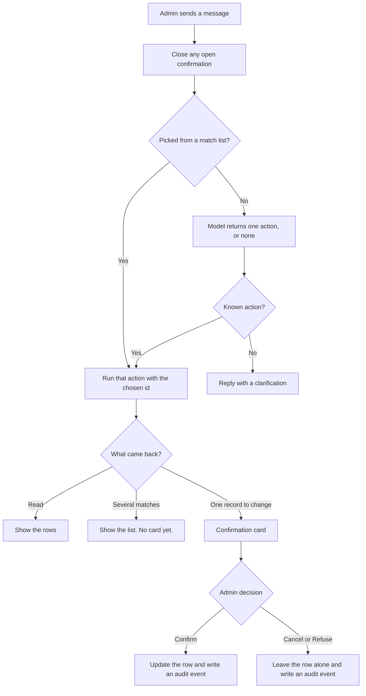
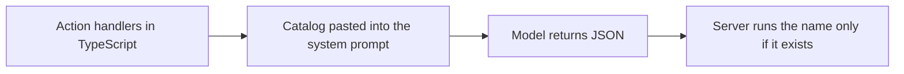

<div align="center">

# MOAD Admin Assistant

An administrator asks in plain language. The server runs one of **75 approved actions** against a synthetic Supabase database. The model never writes SQL, and a change is saved only after **Confirm**.

[](https://nextjs.org/)
[](https://www.typescriptlang.org/)
[](https://supabase.com/)
[](#what-it-can-do)

**Assistant** · **Question guide** · **Record tables**

</div>

---

## What this is

MOAD runs campaigns on cargo vehicles. This assistant is the admin desk for that work: advertisers, driving partners, applications, settlements, Solo Pay, FAQs, and notices.

The language model only chooses an action name and its arguments. TypeScript handlers do the lookup and the update. Credentials stay on the server.

| | |
|---|---|
| Reads | 23. They answer immediately. |
| Writes | 52. They open a confirmation card. |
| Guide questions | 86. Every action has at least one example. |
| Data | Synthetic rows from `npm run seed`. This app does not call the MOAD production database. |

## How a message is handled



A greeting such as “hello” is not a special case in the app. The model returns no action, and the server answers with the clarification.



## Confirm, cancel, refuse

A write is inserted as a pending action. Nothing in the business table changes until Confirm.

| Button | Record | Audit event |
|---|---|---|
| Confirm | Updated, if the row still matches the card | confirm |
| Cancel | Unchanged | cancel |
| Refuse | Unchanged | refuse |

If the row changed after the card was created, Confirm is refused and nothing is written. Cancel and Refuse differ only in the label stored on the pending action and in the audit log.

Shared names such as Blue Depot, Minho Park, or City Wrap return every match. The confirmation card opens only after one row is chosen.

Some writes stay locked after a later status:

- Cargo settlement amounts, distance, and operation count can change only while the row is **before settlement**.
- Advertiser discount and final payment can change only while the bill is **before payment**.
- A blacklist reason can be set only for someone who is already blacklisted.

## Screens

| Screen | Address | What you do there |
|---|---|---|
| Assistant | `/` | Ask a question, confirm a change, or open the audit log. |
| Question guide | `/guide` | Browse 86 example questions. **Ask this** drops one into the chat. |
| Records | `/tables` | Read-only boards for every admin list. Refresh a board to reload it. |
| Sign in | `/login` | Session cookie. There is no public registration. |

The sidebar also opens **Admins**. The signed-in administrator can add another admin or deactivate one. A deactivated admin cannot sign in. You cannot deactivate yourself or the primary account.

Pinned FAQs and notices show a pin icon in the number column. Other rows keep their number.

## What it can do

The live list is the Question guide. These are the groups.

| Group | Questions | Examples |
|---|---:|---|
| Advertisers | 9 | Count approved companies. Change name, email, phones, status, or blacklist reason. |
| Cargo partners | 11 | Find a partner. Change member number, vehicle, region, fixed location, or status. |
| Campaigns | 11 | Create an ad. Change its name, company, period, contact, status, or recruitment. Stop one. |
| Applications | 10 | Change application status or region. Partner fields update the cargo partner. |
| Distance | 2 | Kilometres in a date range, and operating days for a partner on a campaign. |
| Operating-partner settlements | 11 | Summarize a month. Set operation count, distance, fees, base, extras, tax, or the final amount. Confirm. |
| Advertiser settlements | 7 | Set the discount or final payment. Confirm payment. The contact person is the campaign contact. |
| Solo Pay | 8 | Link or unlink a wallet, set Moad money, deduct, and read history. Contact fields belong to the advertiser. |
| FAQ | 8 | Create, pin, unpin, hide, reorder, or delete a question. |
| Notices | 9 | Create, retitle, recategorize, pin, unpin, reorder, or delete a notice. |

Ongoing campaigns on the Solo Pay board are a count of current campaigns. That number is not edited directly. Setting a Moad money balance records the difference as a recharge or a deduction.

## Setup

1. Create a Supabase project and open the SQL editor.
2. Run [`supabase/schema.sql`](supabase/schema.sql). It creates the tables and adds `blacklist_reason` when that column is missing.
3. Copy `.env.example` to `.env.local` and fill in the four required values below.
4. Install, seed, and start:

```bash
npm install
npm run seed
npm run dev
```

Open [http://localhost:3000](http://localhost:3000).

The seed creates one active administrator:

| | |
|---|---|
| Name | MOAD Admin |
| Username | `moad_ai_assistant` |
| Password | `Moad@123` |

Change `BOOTSTRAP_ADMIN_PASSWORD` before seeding if this database is shared.

## Environment

Copy `.env.example` to `.env.local`. None of these keys use the `NEXT_PUBLIC_` prefix, so they are not sent to the browser.

| Variable | Required | Purpose |
|---|---|---|
| `SUPABASE_URL` | Yes | Supabase project URL. |
| `SUPABASE_SERVICE_ROLE_KEY` | Yes | Server-side database access. |
| `AI_API_KEY` | Yes | Chat completions key. Groq by default. |
| `AUTH_SECRET` | Yes | Signs the `moad_session` cookie. |
| `AI_MODEL` | No | Defaults to `openai/gpt-oss-120b`. |
| `AI_BASE_URL` | No | Defaults to `https://api.groq.com/openai/v1`. |
| `AI_JSON_MODE` | No | Asks the provider for a JSON object. |
| `BOOTSTRAP_ADMIN_*` | No | First administrator created by `npm run seed`. |

Any OpenAI-compatible chat completions endpoint works. Set `AI_BASE_URL` and `AI_MODEL` together.

## Scripts

| Command | What it does |
|---|---|
| `npm run dev` | Next.js dev server at port 3000. |
| `npm run seed` | Inserts the synthetic administrators and business rows. |
| `npm run lint` | ESLint. |
| `npm run build` | ESLint, `tsc --noEmit`, then the production build. |
| `npm start` | Serves the production build. |

## Project map

```text
src/app/(console)     Assistant, guide, and record tables
src/app/api/chat      Interpret a message, or resume a chosen match
src/app/api/actions   Confirm, cancel, or refuse a pending write
src/app/login         Sign-in page
src/lib/actions       The 75 approved handlers
src/lib/narrate.ts    Builds the action catalog and calls the model
src/lib/ai.ts         OpenAI-compatible chat completion
src/lib/guide.ts      The 86 example questions
src/lib/client-lists  Rows shown on the record tables
supabase/schema.sql   Tables, including audit, chat, and pending actions
scripts/seed.ts       Synthetic data
```

## Safety

- The model receives action names and descriptions. It does not receive the service role key or a SQL connection.
- An unknown action name is rejected. The server does not run arbitrary code from the model.
- Reads query through the approved filters. Writes go through `commitAction` after Confirm.
- Confirm, cancel, and refuse each leave an audit row. The Activity drawer on the assistant shows them.
- A new chat message expires any confirmation that is still open.
